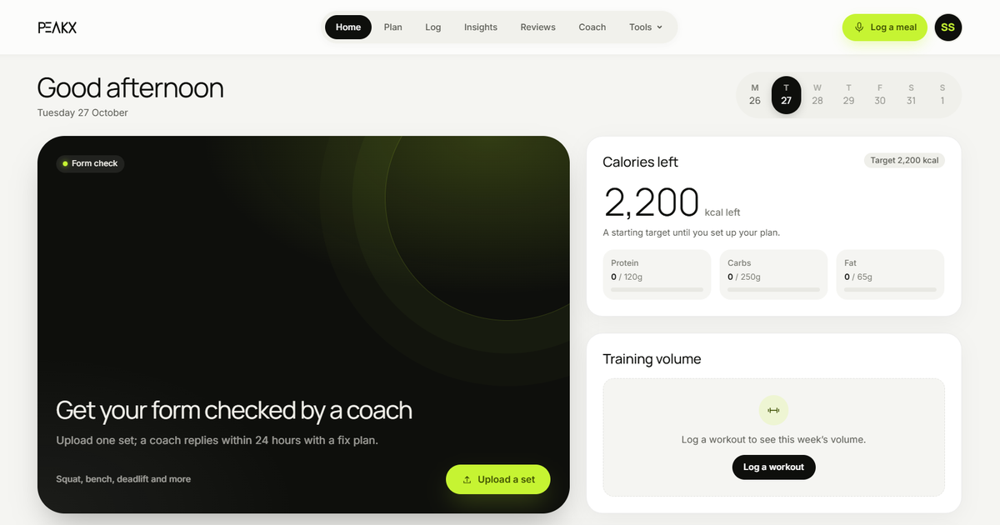

# PeakX

[](https://peakx.live)

**Live:** [peakx.live](https://peakx.live)

PeakX is fitness and nutrition coaching for Indian gym-goers who have hit a plateau. It has four parts:

- **Voice meal logging** in English or Hindi, with calories for every meal.
- **An Indian recipe library and meal plan** built around your targets.
- **Training plans** with set-by-set logging.
- **A weekly answer** on what to change.

This repo is the whole product. It contains the web app (React + Vite, deployed on Vercel) and the serverless functions in `api/` that run AI, payments, wearables and email.

---

## What you see

The app opens on **Home** at `/`. The marketing page lives at `/welcome`.

A new visitor starts with an empty account on the Free plan. The demo account (Arjun, 26, Gurugram, with 28 days of meals, workouts, weights and Fitbit data) is opt-in. Load it from **See a demo** on Home, from the website, or from **Account → Test this build**.

### Main navigation (pill nav at the top, a dock on phones)

| Page | Route | What it does | Plan |
| --- | --- | --- | --- |
| Home | `#/` | Week strip, set-up banner, calories left with macros, training volume, steps/sleep/resting HR, plateau result, weight trend, and today's plan in the dark band | Free |
| Plan | `#/app/plan/meals` | **This week**: day strip, each day's meals (swap, log), grocery list, the workout with last session's numbers, and Recovery today | Pro |
| Log | `#/app/log` | Voice-first food log. Say the meal, check the items, answer "how much?" for anything said without an amount, and save. Typing is the fallback. A dark band shows where the day lands while a meal is waiting to be saved. | Free |
| Insights | `#/app/insights` | 7-day / 4-week / 8-week stats, calories vs weight, workout heatmap, lift trends, connected apps | Free (detailed analytics Pro) |
| Reviews | `#/app/reviews/weekly/latest` | Weekly report: what changed and what to do, with Accept / Skip | Pro (first report free) |
| Coach | `#/app/coach` | AI coach chat that knows your plan, plateau result and last 7 days | Pro |

### Tools menu

| Tool | Route | Plan |
| --- | --- | --- |
| Plateau check | `#/app/plateau-check` | Free |
| Form Check | `#/app/reviews/form-check` (report: `/:id`) | Pro |
| Blood work | `#/app/reviews/blood-work` | Pro |
| Devices | `#/app/devices` (Fitbit / Google Fit, Strava, reminders, calendar) | Free |
| Coach desk | `#/app/coach-desk` (shown only to coaches) | Coaches |

**Recipes** (`#/app/plan/recipes`, Free) is a tab inside Plan, with its own search.

### Other pages

| Page | Route |
| --- | --- |
| Website | `#/welcome` |
| Log in / sign up | `#/login`, `#/app/sign-up` |
| Onboarding (6 steps) and plan ready | `#/app/start/:step`, `#/app/start/plan` |
| Workout session | `#/app/log/workout` |
| Mess mode, eating out, sport program | `#/app/plan/mess`, `#/app/plan/eating-out`, `#/app/plan/sport/badminton` |
| Detailed analytics | `#/app/insights/analytics` |
| Pricing | `#/app/upgrade` |
| Account | `#/app/account` |
| Legal | `#/privacy`, `#/terms`, `#/refunds`, `#/disclaimer`, `#/contact` |

**Pricing** comes from `src/data/founding.ts`:

- Founding cohort: ₹999 for the first 4 weeks (25 places).
- Pro after that: ₹399/month or ₹3,999/year.
- Coached: "On request" until a price is set.

---

## Look and feel

The app was redesigned in October 2026 from Stitch screens. The brief and reference screens are in `design/`:

- `design/REDESIGN.md`: tokens, shell, components, content rules and the quality bar.
- `design/stitch/`: the Stitch screens (`screen.png` plus `code.html` for spacing). These are a visual reference only; the app does not use their code.

The design in short:

- **Surfaces:** warm canvas `#F5F5F2`, white glass cards with a 24px radius, and a near-black band `#0E0F0C` for "today" content.
- **Type:** Manrope (light, large numbers and titles) and Inter (text), both self-hosted.
- **Colour:** black pills for primary actions. Lime `#C6F432` only for progress, hero accents and the Pro badge. Coral only for plateau risk and warnings.
- **Layout:** glass top bar with the wordmark, a centred pill nav, a Tools menu, the lime **Log a meal** mic and an avatar menu (plan tier, Add to home screen). There is no top-bar search or notifications bell. Under 768px it becomes a floating dock with the mic raised in the middle.
- **Content:** plain coaching language, Indian food and portions (katori, roti, plate), Fitbit and Google Fit only. Every screen has an empty state, and Pro screens blur behind a lock card.
- **Quality bar:** works at 1440px and 390px with no horizontal scroll, has keyboard-usable menus, and respects reduced motion.

---

## Run it

```bash
npm ci
npm run dev      # http://localhost:5173
npm test         # Vitest
npm run build    # type-checks app and api/, then builds to dist/
```

Without any environment variables the app runs fully in the browser: data is saved on the device and every AI feature falls back to built-in rules.

## Deploy

Vercel deploys every push to `main`.

- **Build settings:** Vite defaults (build `npm run build`, output `dist`).
- **Routes:** use `#/…`, so no rewrite rules are needed for the app.
- **Domain:** Vercel → Settings → Domains → add `peakx.live` and `www.peakx.live`, then add the DNS records Vercel shows at the registrar (GoDaddy).
- **Site URL variables:** set `SITE_URL` and `VITE_SITE_URL` to `https://peakx.live`.

---

## Configuration

Put local values in `.env.local`, which git ignores. Production values go in Vercel → Settings → Environment Variables.

### In the app (public, `VITE_`)

| Name | Purpose |
| --- | --- |
| `VITE_SITE_URL` | Canonical and share-image links |
| `VITE_SUPABASE_URL`, `VITE_SUPABASE_ANON_KEY` | Accounts and sync. The anon key is the publishable key; row-level security protects the data. |
| `VITE_SUPABASE_GOOGLE` | `true` once the Google provider is on in Supabase (shows "Continue with Google") |
| `VITE_TELEMETRY_URL` | Optional. `/api/events` turns on the built-in usage and error collector. |
| `VITE_RELEASE` | Optional release label on reports |

`.env` in the repo holds only these public values.

### On the server (Vercel only, never `VITE_`)

| Name | Used for |
| --- | --- |
| `GEMINI_API_KEY`, `GEMINI_MODEL` | Voice parsing, meal plan, mess menu, findings, Coach, lab reports |
| `FIREBASE_SERVICE_ACCOUNT`, `FIREBASE_STORAGE_BUCKET` | Legacy server data for reports, wearables, coach desk, usage (not yet moved to Supabase) |
| `SUPABASE_URL`, `SUPABASE_SERVICE_ROLE_KEY` | Server access to Supabase: verifies sign-ins on `/api` and stores billing (tables `billing`, `pay_subscriptions`, `pay_payments`, `pay_events`, `app_meta`) |
| `RAZORPAY_KEY_ID`, `RAZORPAY_KEY_SECRET` | Payments. Keys alone switch on one-time payments with Razorpay Standard Checkout: `POST /api/create-order { kind }` → Checkout with `order_id` → `POST /api/verify-payment` checks HMAC-SHA256(`order_id|payment_id`) and unlocks the plan for one period. |
| `RAZORPAY_WEBHOOK_SECRET`, `RAZORPAY_PLAN_MONTHLY`, `RAZORPAY_PLAN_YEARLY`, `RAZORPAY_PLAN_COACHED` | Optional. Webhook `https://www.peakx.live/api/pay-webhook` (`payment.captured`, `refund.processed`, `subscription.*`) unlocks orders even if the tab closed. A plan id turns that kind into a renewing subscription (Pro Monthly ₹399, Pro Yearly ₹3,999; the founding cohort reuses the monthly plan with a ₹999 add-on). |
| `RESEND_API_KEY`, `REPORTS_FROM`, `REPORTS_AUTO_APPROVE` | Weekly report and reminder emails |
| `CRON_SECRET`, `FEED_SECRET` | Scheduled jobs, calendar feed and unsubscribe links |
| `GOOGLE_HEALTH_CLIENT_ID`, `GOOGLE_HEALTH_CLIENT_SECRET` | Fitbit and Google-linked watches (Google Health API) |
| `STRAVA_CLIENT_ID`, `STRAVA_CLIENT_SECRET` | Strava |
| `COACH_TOKEN` | Setup code coaches enter once on the coach desk |
| `ENFORCE_PLANS` | `true` to require Pro on the server for the AI Coach |
| `SITE_URL` | Links in emails and OAuth redirects |

`GET /api/health` reports which server features are switched on. The app uses it to choose AI or the built-in fallback.

---

## Accounts and sync (Supabase)

Accounts are local-first. The app always saves to the browser (`localStorage`, key `peakx.data.v1`). When someone is signed in, changes are also written to Supabase, debounced.

- **Sign-in:** email and password through the `signup` edge function, which creates a confirmed account so there is no email to wait for. Google is available once its provider is on.
- **Tables** (all with row-level security, so each member reaches only their own rows):
  - `user_data(user_id, data jsonb)`: the member's whole app state.
  - `queue_items(id, user_id, item)`: Form Checks, lab checks, unmatched foods and coach requests.
  - `email_prefs(user_id, prefs)`: reminder settings.
- **Storage:** private bucket `form-videos/{user_id}/…` for Form Check uploads.
- **First sign-in:** an empty account takes what's on the device. A demo device never uploads the demo. An account that already has data loads that data.
- **Sign-out and deletion:** signing out clears the device copy. Delete account removes the auth user and all their rows.
- **Supabase dashboard:**
  - Authentication → URL Configuration: set the Site URL to `https://peakx.live` and add the Vercel preview domain to the redirect URLs.
  - For Google sign-in, also add the Google OAuth client.
- The table SQL, RLS policies and the `signup` function live in the Supabase project "peakx", not in this repo yet.

---

## Server features (`api/`)

There are 10 Vercel functions. The AI tasks share `/api/ai` through rewrites in `vercel.json`.

| Feature | Endpoint | Needs |
| --- | --- | --- |
| AI: voice parsing, meal plan, mess menu, findings, Coach, lab reports | `/api/meal`, `/api/menu`, `/api/findings`, `/api/coach`, `/api/labs` | `GEMINI_API_KEY` (falls back to rules without it) |
| Payments (Razorpay subscriptions, founding counter, refunds) | `/api/pay`, `/api/pay-webhook` | Razorpay keys and server data |
| Weekly reports (draft Sun 6 PM IST, publish 7 PM IST, email) | `/api/cron/reports` | Gemini, Resend, server data |
| Daily job (wearable sync, 9 PM log nudge, re-test emails) | `/api/cron/daily` at 9 PM IST | `CRON_SECRET`, Resend, server data |
| Wearables (OAuth connect and disconnect, sync on open) | `/api/devices` | Google Health / Strava keys and server data |
| Coach desk (one queue with time tracking, coach setup) | `/api/ops` | `COACH_TOKEN` and server data |
| Calendar feed and unsubscribe | `/api/feed`, `/api/calendar.ics` | `FEED_SECRET` |
| Usage and errors | `/api/events` | server data |

Razorpay setup (start in Test mode):

1. Create a monthly plan at ₹399 and a yearly plan at ₹3,999. The server refuses to sell if a plan's price differs from `src/data/founding.ts`.
2. Add the webhook `https://peakx.live/api/pay-webhook` with the `subscription.*`, `payment.captured` and `refund.processed` events.

Google Health and Strava use the redirect URI `https://peakx.live/api/devices`.

### Status

Accounts moved from Firebase to Supabase on 16 Oct. The serverless functions have not moved yet: they still read data with Firebase Admin and check Firebase sign-in tokens. Until they are ported to Supabase:

- AI features work, with or without sign-in.
- Payments, wearable connect, the coach desk, server-built weekly reports and the usage collector will not recognise a Supabase sign-in.
- The app shows Free unless a plan is switched under Account → Test this build, because `watchBilling` returns nothing until payments run on Supabase.
- `.env.example`, `firebase.json`, `firestore.rules` and `storage.rules` still describe the Firebase setup.

Porting `api/_lib/admin.ts` to Supabase (service-role key, `user_data` and `queue_items`) is the next backend step.

---

## How the code is organised

```
src/
  App.tsx                routes (HashRouter), screens load on demand
  styles/peakx.css       design tokens and every component class
  components/
    Shell.tsx            AppShell: glass top bar, pill nav, Tools and avatar menus, mobile dock, Pro lock
    ui/                  GlassCard, Stat, MacroBar, Sparkline, BarSpark, Ring, HalfGauge, Heatmap,
                         WeekStrip, Chip, Badge, PillButton, DarkBand, EmptyState (charts are inline SVG)
    VoiceLogPanel.tsx    voice capture, parsed items, "how much?" portions
    FoodLog.tsx, Wizard.tsx, Checkout.tsx, Reminders.tsx, …
  screens/W01…W24        one file per screen (W24 is the coach desk)
  domain/                pure logic: types, nutrition maths (Mifflin-St Jeor, Epley 1RM), foods (IFCT 2017),
                         meal parser, plateau scoring, training progression, recipes, reports, labs, form check
  state/                 store (reducer), selectors (every derived number), entitlements (canUse),
                         repository (localStorage), cloud and auth (Supabase), ai, billing, devices, telemetry
  data/                  nav and shortcuts, release map, founding prices, legal text
  __tests__/             Vitest
api/                     Vercel functions; api/_lib holds Gemini, Razorpay, wearables, email and server data
design/                  redesign brief and Stitch reference screens
docs/plans/              working plans (e.g. the 16 Oct submission fixes)
```

These rules keep the code consistent:

- **Thin screens.** Screens read through selectors and change data only by dispatching actions.
- **One place for gating.** Free / Pro / Coached checks go only through `canUse(feature)`. Pro pages pass `feature` to `AppShell` to get the lock.
- **No dead buttons.** Anything not built yet shows a toast naming its release (`src/data/roadmap.ts`).
- **Food data.** The catalogue has 68 ingredients and 61 dishes, with Hindi aliases and katori/roti portions. Values are marked "estimated" until the nutrition team reviews them.
- **Draft content.** The 12 recipes, plateau questions, lab ranges and form drills are drafts for the coaching team.

## Tests and CI

`npm test` runs 175 tests in 19 files. They cover:

- nutrition maths, food search and the voice meal parser
- plateau scoring, onboarding, training progression
- insights and report selectors, billing rules, cloud data mapping
- the UI geometry, and a check that every `api/` import loads on Vercel

GitHub Actions (`.github/workflows/ci.yml`) type-checks the app and `api/`, runs the tests and builds on every push and pull request. Vercel builds a preview for every branch.

## Not on web

Barcode or plate scanning, glucose monitors, Apple Health and Garmin are not on the web app. Apple Health and Garmin need a native app or partner programmes.
